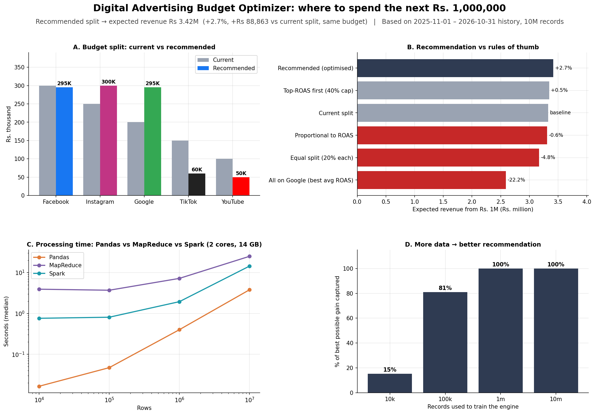

# 📊 Digital Advertising Budget Optimizer

**Where should a company spend its next Rs. 1,000,000 across Facebook, Instagram, Google, TikTok and YouTube?**
An end-to-end big data analytics project: synthetic data at scale, KPI analysis with Pandas, Hadoop MapReduce and Apache Spark,
a fair benchmark of the three, and a validated budget recommendation engine.




## Key results

**Recommended split of Rs. 1,000,000:** expected revenue **Rs 3.42M**,
**+2.7% (Rs 88,863) more** than the current split for the same budget.

| Platform | Current | Recommended | Change |
|---|---|---|---|
| Facebook | Rs 300,000 | **Rs 295,000** | -5,000 |
| Instagram | Rs 250,000 | **Rs 300,000** | +50,000 |
| Google | Rs 200,000 | **Rs 295,000** | +95,000 |
| TikTok | Rs 150,000 | **Rs 60,000** | -90,000 |
| YouTube | Rs 100,000 | **Rs 50,000** | -50,000 |

- **Diminishing returns change the answer:** putting everything on the highest-ROAS platform would lose 22% of revenue.
  The engine equalises *marginal* ROAS instead.
- **Validated three ways:** back-test on unseen months (3.7% error vs 6.2% for constant ROAS),
  recovery of the true market parameters (within 1%), and 200-run bootstrap confidence ranges.
- **Big data improved the decision:** the engine captured 15% of the achievable gain when trained on 10K records and 100% on 10M.
- **Tool benchmark (10m rows, 2-core Colab VM):** Pandas 3.8s, MapReduce 24.9s, Spark 14.4s.
  MapReduce and Spark reproduced the Pandas results on all 1,890 result groups.

📄 **Full report:** [outputs/reports/FINAL_REPORT.md](outputs/reports/FINAL_REPORT.md)

## Notebooks

| # | Notebook | What it does | Run |
|---|---|---|---|
| 01 | `01_setup_and_data_generation.ipynb` | Builds the project on Google Drive and generates synthetic ad data (10K → 10M rows) | [](https://colab.research.google.com/github/hamzahalim-dev/ad-budget-optimizer/blob/main/notebooks/01_setup_and_data_generation.ipynb) |
| 02 | `02_eda_kpis_pandas.ipynb` | Data quality checks; CTR, CPC, CPA, conversion rate, ROAS by platform, campaign, audience and time | [](https://colab.research.google.com/github/hamzahalim-dev/ad-budget-optimizer/blob/main/notebooks/02_eda_kpis_pandas.ipynb) |
| 03 | `03_mapreduce_hadoop.ipynb` | Same KPIs with Hadoop Streaming MapReduce; in-mapper combining; validation vs Pandas | [](https://colab.research.google.com/github/hamzahalim-dev/ad-budget-optimizer/blob/main/notebooks/03_mapreduce_hadoop.ipynb) |
| 04 | `04_spark_pyspark.ipynb` | Same KPIs with Spark DataFrames and SQL; execution plans, caching, grouping sets, CSV vs Parquet | [](https://colab.research.google.com/github/hamzahalim-dev/ad-budget-optimizer/blob/main/notebooks/04_spark_pyspark.ipynb) |
| 05 | `05_benchmark.ipynb` | Fair head-to-head benchmark of Pandas vs MapReduce vs Spark, plus Pandas memory limits | [](https://colab.research.google.com/github/hamzahalim-dev/ad-budget-optimizer/blob/main/notebooks/05_benchmark.ipynb) |
| 06 | `06_recommendation_engine.ipynb` | Response curves + optimiser → budget split for Rs. 1M; back-test, bootstrap, answer-key validation | [](https://colab.research.google.com/github/hamzahalim-dev/ad-budget-optimizer/blob/main/notebooks/06_recommendation_engine.ipynb) |
| 07 | `07_final_report.ipynb` | Executive dashboard, final report and these GitHub files | [](https://colab.research.google.com/github/hamzahalim-dev/ad-budget-optimizer/blob/main/notebooks/07_final_report.ipynb) |

## Methodology

1. **Data:** a seeded generator (`src/adgen.py`) simulates 12 months of campaign × audience × day records with realistic platform economics,
   audience mixes, Pakistani shopping seasons and diminishing returns. Same rules at 10K / 100K / 1M / 10M rows.
2. **KPIs:** CTR, CPC, conversion rate, CPA and ROAS, always as ratios of totals (`src/kpis.py`), used identically by every engine.
3. **MapReduce:** Hadoop 3.3.6 Streaming with Python mapper/reducer (`src/mapreduce/`), in-mapper combining, multi-key single-pass job.
4. **Spark:** PySpark DataFrames and SQL, `GROUPING SETS`, caching and Parquet column pruning.
5. **Benchmark:** same task, same input, same session, warm-up + 3 repetitions, every answer checked.
6. **Recommendation engine** (`src/engine.py`): log-log response curves per platform → constrained optimisation (SLSQP)
   → validation (hold-out back-test, answer key, bootstrap).

## Repository structure

```
ad-budget-optimizer/
├── notebooks/              # 01–07, run in order
├── src/
│   ├── adgen.py            # synthetic data generator
│   ├── kpis.py             # KPI definitions (single source of truth)
│   ├── viz.py              # chart style
│   ├── engine.py           # recommendation engine
│   ├── mapreduce/          # mapper.py, mapper_naive.py, reducer.py
│   └── bench/              # isolated Pandas benchmark job
├── config/generator_config.json   # market rules = answer key
├── data/sample/ads_10k.csv        # 10K-row sample (full data is regenerated by notebook 01)
└── outputs/
    ├── figures/            # all charts
    ├── reports/            # KPI tables, validation, findings, FINAL_REPORT.md
    └── benchmarks/         # raw and summarised timings
```

## How to run

1. Open any notebook with its **Open in Colab** button (or upload it to [Google Colab](https://colab.research.google.com)).
2. Run the notebooks **in order (01 → 07)**, each with *Runtime → Run all* on a standard CPU runtime, and allow Google Drive access when asked.
3. Everything is stored in `MyDrive/ad-budget-optimizer/` (about 2–3 GB including Hadoop). Java, Hadoop and Spark are installed automatically.

The full datasets are **not** in this repository (the 10M-row CSV alone is ~0.9 GB). Notebook 01 regenerates them
**identically** from a fixed random seed (42).

## Tech stack
Python · Pandas · NumPy · PyArrow / Parquet · Apache Hadoop 3.3.6 (MapReduce, Streaming) · Apache Spark (PySpark, Spark SQL)
· SciPy (optimisation) · Matplotlib · Google Colab · Google Drive

## Limitations
Synthetic data; a simple response model without carry-over or cross-channel effects; revenue (not profit) objective;
single-machine benchmark. See section 7 of the [final report](outputs/reports/FINAL_REPORT.md) for next steps.

## Author
**Hamza Halim**, Big Data Analytics project, November 2026
