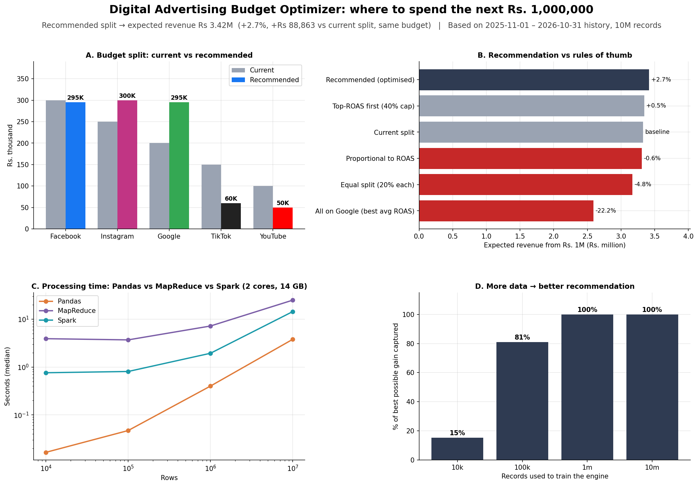
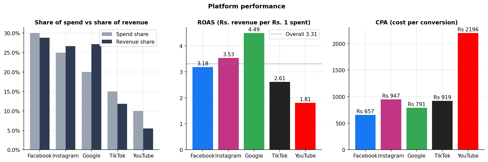
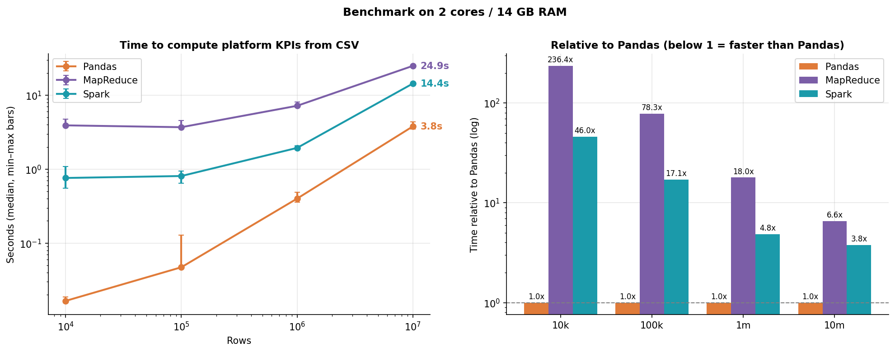
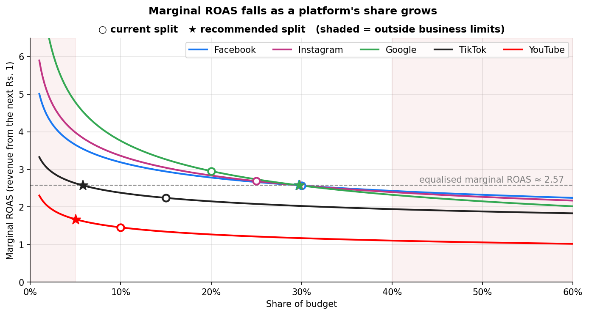
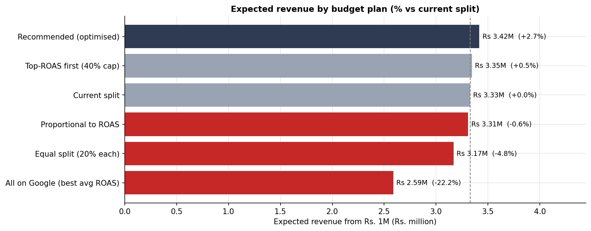

# Digital Advertising Budget Optimizer: Final Report

**Author:** Hamza Halim · **Course:** Big Data Analytics · **Date:** 01 November 2026

## Executive summary

- **Recommendation:** split the next Rs. 1,000,000 as **Facebook Rs 295K**, **Instagram Rs 300K**, **Google Rs 295K**, **TikTok Rs 60K**, **YouTube Rs 50K**.
- **Expected impact:** Rs 3.42M revenue, **Rs 88,863 (+2.7%) more**
  than the current split for the same budget.
- **Biggest moves:** more to Google, Instagram; less to TikTok, YouTube, Facebook.
- **Why not "all on the best platform":** every platform shows diminishing returns. Putting the full budget on the platform with
  the best average ROAS would *lose* 22% of revenue.
- **Big data mattered for the answer itself:** trained on 10K records the engine captured 15% of the achievable gain;
  on 10M records, 100%.

## 1. Business question
A company advertises on Facebook, Instagram, Google, TikTok and YouTube. Management asked: *where should we spend the next
Rs. 1,000,000?* The project answers this with big data tools, and compares those tools along the way.

## 2. Data
No company shares millions of rows of real ad data, so a **synthetic data generator** (Notebook 01) simulates 12 months
(2025-11-01 to 2026-10-31) of campaign × audience × day records with realistic rules: platform costs and
conversion rates, audience mixes, Pakistani shopping seasons (11.11, Ramadan/Eid, 14 August) and diminishing returns.
The same rules generated **10K, 100K, 1M and 10M records**, so business results stay constant while data volume grows 1,000×.
Because the rules are known, they also serve as an **answer key** for validating the engine.

## 3. What the data shows
| Platform | Spend share % | Revenue share % | CTR % | CPC (Rs) | Conv. rate % | CPA (Rs) | ROAS |
|---|---|---|---|---|---|---|---|
| Facebook | 30.00 | 28.85 | 1.20 | 12.51 | 1.90 | 657.34 | 3.18 |
| Instagram | 24.99 | 26.68 | 1.00 | 18.00 | 1.90 | 946.97 | 3.53 |
| Google | 20.01 | 27.15 | 3.00 | 30.01 | 3.79 | 791.16 | 4.49 |
| TikTok | 15.00 | 11.86 | 0.80 | 8.75 | 0.95 | 918.90 | 2.61 |
| YouTube | 10.00 | 5.47 | 0.40 | 25.00 | 1.14 | 2,196.01 | 1.81 |

1. **Google** has the highest ROAS (**4.49**) but receives only **20%** of spend.
   **YouTube** has the lowest ROAS (**1.81**), with a CPA of Rs. 2,196.
2. Platforms earning a bigger share of revenue than of spend: Google (+7.1 pts), Instagram (+1.7 pts).
   Platforms earning less than their spend share: Facebook (-1.2 pts), TikTok (-3.1 pts), YouTube (-4.5 pts).
3. **Retargeting** campaigns return the most (ROAS 6.94);
   **Brand** campaigns the least (ROAS 0.88). Brand campaigns build awareness, so judge them on reach, not ROAS alone.
4. Best audience: age **35-44**, city **Islamabad**; **Desktop** users convert best (3.59%).
5. Every platform shows diminishing returns. When daily spend doubles, ROAS falls most on **Google** (-21%)
   and least on **TikTok** (-10%). The best platform today is not automatically the best home for *extra* budget.

## 4. Big data processing: Pandas vs MapReduce vs Spark
The same KPIs were computed three ways. **MapReduce** (Hadoop Streaming) matched Pandas on 7/7 breakdowns and
**Spark** on 7/7 (1,890 groups each); counts were identical, and money totals differed by at most a few paisa (floating-point rounding).

**Benchmark: median seconds to read the CSV and compute platform KPIs** (2 CPU cores, 14 GB RAM, 3 runs each)

| Dataset | Pandas (s) | MapReduce (s) | Spark (s) |
|---|---|---|---|
| 10k rows | 0.02 | 3.91 | 0.76 |
| 100k rows | 0.05 | 3.69 | 0.81 |
| 1m rows | 0.40 | 7.20 | 1.94 |
| 10m rows | 3.79 | 24.95 | 14.39 |

- Pandas needed about **233 MB of RAM per million rows**. Memory, not speed, is its limit.
- Spark and MapReduce stream data in partitions; on a single machine they pay coordination overhead without the benefit of a cluster.
- File format mattered as much as the tool: Parquet was far smaller and faster than CSV for both Pandas and Spark.

## 5. Recommendation engine
1. **Response curves:** for each platform, `revenue = a × spend^β` fitted on 365 days (β < 1 means diminishing returns).
2. **Validation:** on two unseen months the model's daily revenue error was **3.7%** vs 6.2% for the usual
   constant-ROAS assumption; fitted β values were within 1% of the true values.
3. **Optimisation:** the budget is shifted until the next rupee earns the same on every platform (equal *marginal* ROAS),
   with each platform kept between 5% and 40% of budget.
4. **Confidence:** 200 bootstrap re-runs give the 95% ranges below.

## 6. Recommendation for management
| Platform | Current (Rs) | Recommended (Rs) | Change (Rs) | Share | 95% range |
|---|---|---|---|---|---|
| Facebook | 300,000 | 295,000 | -5,000 | 30% | 28–32% |
| Instagram | 250,000 | 300,000 | +50,000 | 30% | 28–32% |
| Google | 200,000 | 295,000 | +95,000 | 30% | 28–32% |
| TikTok | 150,000 | 60,000 | -90,000 | 6% | 5–6% |
| YouTube | 100,000 | 50,000 | -50,000 | 5% | 5–5% |

**Where to spend within each platform**

| platform | prioritise | limit | best age group |
|---|---|---|---|
| Facebook | Retargeting (ROAS 6.7), Promo (3.7) | Brand (ROAS 0.9) | 25-34 (ROAS 3.6) |
| Instagram | Retargeting (ROAS 7.4), Promo (4.1) | Brand (ROAS 0.9) | 25-34 (ROAS 4.0) |
| Google | Retargeting (ROAS 9.4), Promo (5.3) | Brand (ROAS 1.2) | 25-34 (ROAS 5.0) |
| TikTok | Retargeting (ROAS 5.5), Promo (3.1) | Brand (ROAS 0.7) | 25-34 (ROAS 3.1) |
| YouTube | Retargeting (ROAS 3.8), Promo (2.1) | Brand (ROAS 0.5) | 25-34 (ROAS 2.1) |

## 7. Limitations and next steps
- **Synthetic data.** Real data adds tracking gaps, attribution disputes and outliers. Next step: connect the pipeline to real platform exports.
- **Simple response model.** No carry-over (adstock) or cross-channel effects. Next step: a full marketing-mix model (e.g. PyMC-Marketing or Google Meridian).
- **Revenue, not profit or lifetime value.** Next step: add product margins and repeat-purchase value.
- **Prove it before scaling it.** Run the recommended split for 4 weeks against a control region (geo test) to measure the real uplift.
- **Re-run monthly.** Response curves shift with seasons, competition and creative; the engine (`src/engine.py`) is reusable as-is.
- **Single-machine benchmark.** On a real cluster Spark scales out; the tool comparison here reflects single-node behaviour.

## Appendix: detailed findings by notebook

### Notebook 03: MapReduce
**Engine:** Hadoop 3.3.6 (standalone), 2 parallel map slot(s)

1. **Correctness:** 7 of 7 breakdowns (1,890 groups in total) match Pandas.
   Counts are identical; money totals differ by at most Rs. 0.00 (floating-point rounding).
2. **One pass, many answers:** a single job produced all seven breakdowns in 104s,
   instead of reading 10M rows seven times.
3. **Combining matters:** in-mapper combining cut the records sent to the reducer from
   1,000,000 to 15, and job time from 18.4s to 11.5s.
   On a real cluster, the shuffle crosses the network, so this saving is even larger.
4. **Scaling:** 10,000 rows took 5.5s and 10,000,000 rows took 43.5s
   (1,000x the data, 8x the time),
   peaking at 230,097 rows/second. Small jobs are dominated by Hadoop's fixed start-up cost, so MapReduce only pays off on large data.

### Notebook 04: Spark
**Engine:** Spark 4.0.4 local[2]

1. **Correctness:** 7 of 7 breakdowns (1,890 groups) match Pandas,
   including the KPI ratios computed natively in Spark. DataFrame API and SQL give identical answers.
2. **Automatic optimisation:** Spark's planner applied partial aggregation (the equivalent of Notebook 03's
   hand-written in-mapper combining) and column pruning without any extra code.
3. **Reuse strategy:** for seven breakdowns, *GROUPING SETS (1 pass)* was fastest (24.3s vs
   83.0s for the slowest approach). Caching did not help here: the cache stores all 12 columns in memory, while each Parquet query reads only the few columns it needs. Caching pays off when data is reused many times or storage is slow.
4. **File format:** Parquet was 4.8x smaller than CSV and
   9.0x faster to query.
5. **Scaling:** on Parquet, 10K rows took 0.17s and 10M rows 3.06s:
   1,000x the data for 18x the time. Small queries are dominated by
   Spark's fixed per-query overhead.

### Notebook 05: Benchmark
**Machine:** 2 CPU cores, 14 GB RAM (Google Colab) | **Runs:** 36 timed, all correct

1. **Fastest engine by size:** 10k: Pandas, 100k: Pandas, 1m: Pandas, 10m: Pandas.
2. **At 10,000,000 rows:** Pandas 3.8s, Spark 14.4s, MapReduce 24.9s.
   MapReduce was 1.7x slower than Spark. Hadoop writes intermediate data to disk and starts a new JVM for every job, while Spark plans the whole job and keeps data in memory.
3. **Fixed overhead dominates small data:** at 10K rows Pandas took 0.02s,
   Spark 0.76s and MapReduce 3.91s. Distributed engines spend that time
   planning and scheduling, not computing.
4. **Scaling 1M → 10M (10x data):** Pandas 9.5x time, Spark 7.4x,
   MapReduce 3.5x.
5. **Memory is Pandas' real limit:** ~239 MB per million rows for this task, so roughly
   **45 million rows** fit on this machine. Spark and MapReduce stream data in partitions,
   and on a cluster they add machines instead of needing more RAM on one.
6. **File format matters as much as the tool:** at 10,000,000 rows, Parquet took Pandas
   1.1s (CSV: 3.8s) and Spark
   2.4s (CSV: 14.4s).

**Recommendation**
| Situation | Best choice |
|---|---|
| Data fits comfortably in one machine's RAM (here: up to ~45M rows) | **Pandas**: simplest and fast |
| Data larger than RAM, growing, or a scheduled production pipeline | **Spark**: scales out, SQL, optimiser |
| New projects | **Not MapReduce**: Spark replaced it, but its map → shuffle → reduce model underlies all of these tools |

*Caveat:* this is a single 2-core machine. Spark and MapReduce are built for clusters, where they spread work over many machines;
here they pay coordination costs without that benefit. The results show single-machine behaviour, not cluster performance.

### Notebook 06: Recommendation engine
**Recommendation for Rs. 1,000,000:** Facebook Rs 295K (30%), Instagram Rs 300K (30%), Google Rs 295K (30%), TikTok Rs 60K (6%), YouTube Rs 50K (5%).

1. **Expected result:** Rs 3.42M revenue (ROAS 3.42), **Rs 88,863 more (+2.7%)**
   than the current split, for the same budget.
2. **Moves:** increase Google (+Rs 95K), Instagram (+Rs 50K); reduce TikTok (−Rs 90K), YouTube (−Rs 50K), Facebook (−Rs 5K).
3. **Why not all on Google?** It has the best *average* ROAS, but also the steepest diminishing returns
   (β = 0.65). Putting the whole budget there would earn Rs 2.59M
   (-22% vs current). Filling top-ROAS platforms first earns +0.5%.
   The optimised plan wins because it equalises *marginal* ROAS (≈ 2.57 on the unconstrained platforms).
4. **The model is reliable:** on two unseen months it predicted daily revenue with
   3.7% average error (vs 6.2% for constant ROAS),
   recovered the true β within 1%, and the bootstrap ranges are narrow
   (every platform within ±2 points).
5. **Big data made the answer correct:** trained on 10K records the engine captured 15% of the best possible gain;
   on 10M records, 100%.
6. **Within platforms:** shift spend towards retargeting and promo campaigns and the 25–44 age groups;
   judge brand campaigns on reach, not ROAS.
7. **Re-run monthly:** response curves change with seasons, competition and creative. The engine is in `src/engine.py`.
